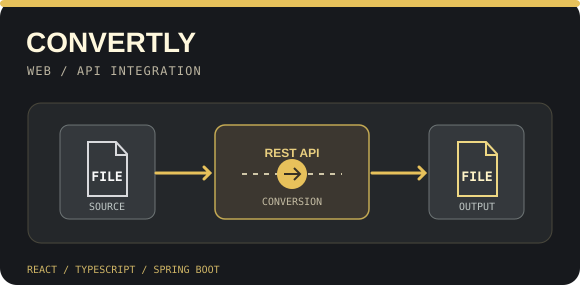
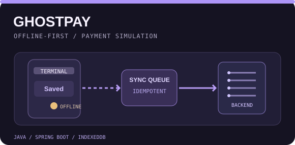
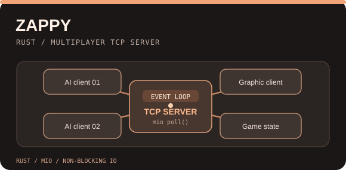

  
  
<b>Java / Spring Boot Developer &nbsp;·&nbsp; Backend & Systems Engineering</b>

  
Building REST APIs, data-driven applications, and networked systems. Third-year EPITECH student with professional client-facing development experience.

  
<b>Open to backend opportunities in Malaysia</b> &nbsp;·&nbsp; Available March 2027 &nbsp;·&nbsp; Relocation and sponsorship required

---

## Technologies I work with

  
<b>Backend-first, with full-stack delivery and systems programming experience.</b>

  <table>
    <tr>
      <td align="center" valign="top" width="50%">
<h3>01 / Backend</h3>

Java · Spring Boot · PHP

<table><tr><td align="center" width="33%"> <b>Java</b></td><td align="center" width="33%"> <b>Spring</b></td><td align="center" width="33%"> <b>PHP</b></td></tr><tr><td align="center" width="33%"> <b>Symfony</b></td><td align="center" width="33%"> <b>Gradle</b></td><td align="center" width="33%"> <b>PostgreSQL</b></td></tr></table>
</td>
      <td align="center" valign="top" width="50%">
<h3>02 / Frontend</h3>

Web application interfaces

<table><tr><td align="center" width="33%"> <b>TypeScript</b></td><td align="center" width="33%"> <b>React</b></td><td align="center" width="33%"> <b>JavaScript</b></td></tr><tr><td align="center" width="33%"> <b>HTML5</b></td><td align="center" width="33%"> <b>CSS3</b></td><td align="center" width="33%"> <b>Node.js</b></td></tr></table>
</td>
    </tr>
    <tr>
      <td align="center" valign="top" width="50%">
<h3>03 / Systems</h3>

Networking & lower-level programming

<table><tr><td align="center" width="33%"> <b>Rust</b></td><td align="center" width="33%"> <b>C</b></td><td align="center" width="33%"> <b>C++</b></td></tr><tr><td align="center" width="33%"> <b>Linux</b></td><td align="center" width="33%"> <b>Git</b></td><td align="center" width="33%"> <b>Docker</b></td></tr></table>
</td>
      <td align="center" valign="top" width="50%">
        <h3>04 / Engineering practices</h3>
        
What I focus on when building software

        

          <b>APIs & data</b> 
          REST · Spring Security · Spring Data JPA · SQL · Flyway  
          <b>Quality & delivery</b> 
          JUnit · Integration tests · Validation · Git · Docker  
          <b>Networked systems</b> 
          TCP/IP · Non-blocking I/O · Event loops · Protocol parsing
        

      </td>
    </tr>
  </table>

## Selected projects

<table>
  <tr>
    <td valign="top" width="50%">
      
      <h3><a href="https://github.com/YetAnotherFactsEnjoyer/StockFlow">StockFlow</a></h3>
      
<b>Inventory & procurement · In progress</b>

      
Spring Boot and PostgreSQL APIs for products and suppliers with a React workspace. Working on API integration and inventory consistency.

      
Java · Spring Boot · PostgreSQL · React

    </td>
    <td valign="top" width="50%">
      
      <h3>Convertly</h3>
      
<b>File conversion application · Team project</b>

      
Developed the React/TypeScript web application and Spring Boot REST integration connecting conversion workflows to a separate engine.

      
Java · Spring Boot · React · TypeScript

    </td>
  </tr>
  <tr>
    <td valign="top" width="50%">
      
      <h3><a href="https://github.com/YetAnotherFactsEnjoyer/GhostPay">GhostPay</a></h3>
      
<b>Offline-first payment simulation</b>

      
Local transaction capture during connectivity outages and idempotent batch synchronization. Simulation only; no real payments.

      
Java · Spring Boot · PostgreSQL · TypeScript

    </td>
    <td valign="top" width="50%">
      
      <h3><a href="https://github.com/YetAnotherFactsEnjoyer/zappy">Zappy</a></h3>
      
<b>Multiplayer TCP server · Team project</b>

      
Developed the Rust server using non-blocking socket polling, protocol parsing, queued commands, and shared game state.

      
Rust · mio · TCP/IP · Non-blocking I/O

    </td>
  </tr>
</table>

## Professional experience

**Junior Web Developer Intern · Anybug** — Sep–Dec 2025

Primary developer of a business-used AI photo-analysis and image-generation application, including its **Symfony backend**, administration interface, frontend and OpenAI integration. Also contributed to museum experiences, e-commerce back-office workflows, and client demonstrations.

---

  <b>Build thoughtfully. Test the failure paths. Keep learning.</b>
  
<a href="https://github.com/YetAnotherFactsEnjoyer?tab=repositories">Explore repositories</a>

