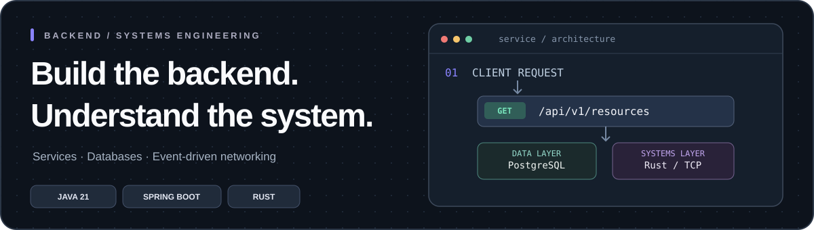
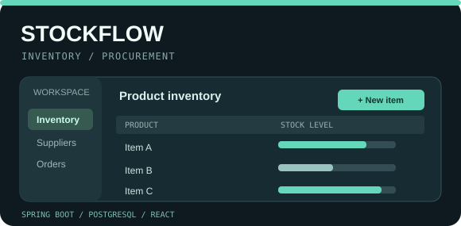

 

### Java / Spring Boot · Backend & Systems Engineering

Building APIs, data-driven applications, and networked systems.  
Third-year **EPITECH** student with professional client-facing development experience.

**Open to full-time backend roles in Malaysia** · Available from **March 2027** · Relocation / sponsorship required

 

---

## Selected work

<table>
<tr>
<td width="50%" valign="top">

**[StockFlow](https://github.com/YetAnotherFactsEnjoyer/StockFlow)** · *In progress*

Spring Boot / PostgreSQL backend for product and supplier workflows, with a React workspace. Working on API integration and inventory consistency.

`Java` `Spring Boot` `PostgreSQL` `React`
</td>
<td width="50%" valign="top">

**Convertly** · *Team project*

React / TypeScript file-conversion interface and Spring Boot REST integration with a separate conversion engine. Worked on web workflows, format handling and API boundaries.

`Java` `Spring Boot` `React` `TypeScript`
</td>
</tr>
<tr>
<td width="50%" valign="top">

**[GhostPay](https://github.com/YetAnotherFactsEnjoyer/GhostPay)** · *Simulation only*

Offline-first payment simulation with local transaction capture and idempotent synchronization after connectivity returns. No real money involved.

`Java` `Spring Boot` `PostgreSQL` `TypeScript`
</td>
<td width="50%" valign="top">

**[Zappy](https://github.com/YetAnotherFactsEnjoyer/zappy)** · *Team project*

Built the Rust side of an event-driven multiplayer TCP server: non-blocking socket polling, protocol parsing, queued commands and shared game state.

`Rust` `mio` `TCP/IP` `Non-blocking I/O`
</td>
</tr>
</table>

## Professional experience

**Junior Web Developer Intern · Anybug** — Sep–Dec 2025

Primary developer of a business-used AI photo-analysis and image-generation application, covering its Symfony backend, administration interface, frontend and OpenAI integration. Also contributed to museum experiences and e-commerce back-office workflows, with client demonstrations and acceptance testing.

## Engineering toolkit

**Backend & APIs**

Java 21 · Spring Security · Spring Data JPA · REST APIs · JWT

**Databases & delivery**

SQL · Flyway · JUnit · Integration testing

**Frontend**

**Systems**

TCP/IP · Event loops · Non-blocking I/O · Protocol parsing

---

**Build thoughtfully. Test failure paths. Keep learning.**

[Explore repositories](https://github.com/YetAnotherFactsEnjoyer?tab=repositories)

