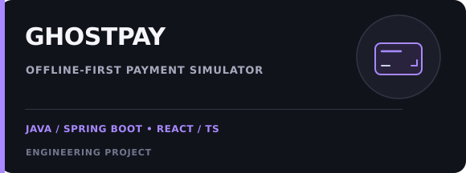

<div align="center">


<a href="https://github.com/YetAnotherFactsEnjoyer">
  
</a>

<br/>


[](https://github.com/YetAnotherFactsEnjoyer?tab=repositories)
[](https://github.com/YetAnotherFactsEnjoyer/StockFlow)

</div>

<br/>

## 👋 About me

I'm **Raphaël**, a software engineering student at **Epitech Technology**. I build across the stack, from **Java / Spring Boot** services and **React / TypeScript** apps to relational databases and lower-level **Rust / C / C++** systems.

I care about what happens *after* the demo works: correct business rules, readable structure, reliable APIs and tested failure cases.

<table>
<tr>
<td width="50%" valign="top">

#### 🎯 Currently
- Deepening **Java backend engineering**
- Improving **StockFlow** (security, inventory consistency, UI ↔ API wiring)
- Building things I can **understand, explain and maintain** end to end

</td>
<td width="50%" valign="top">

#### 🧭 How I work
- Model the domain before writing endpoints
- Make operations **idempotent** where retries happen
- Write tests for the unhappy path first
- Keep code boring, readable and documented

</td>
</tr>
</table>

<br/>

## 🚀 Featured projects

<table>
<tr>
<td width="50%" valign="top">
  
  <h3>👻 GhostPay</h3>
  <p>Offline-first <strong>payment simulation</strong> with authenticated terminals, browser-local capture, reconnect-and-sync flows, <strong>idempotent batch replay</strong> and solid test coverage.</p>
  <p>
    
  </p>
  <sub>Spring Security · Flyway · IndexedDB</sub>
  <br/><br/>
  
  
</td>
<td width="50%" valign="top">
  <a href="https://github.com/YetAnotherFactsEnjoyer/StockFlow"></a>
  <h3>📦 <a href="https://github.com/YetAnotherFactsEnjoyer/StockFlow">StockFlow</a></h3>
  <p>Inventory and procurement platform with products, suppliers, relational backend models and a React workspace. Now connecting the UI to the APIs and hardening security and stock consistency.</p>
  <p>
    
  </p>
  <br/>
  
  
</td>
</tr>
<tr>
<td width="50%" valign="top">
  <a href="https://github.com/Xartania/Convertly"></a>
  <h3>🔁 <a href="https://github.com/Xartania/Convertly">Convertly</a></h3>
  <p>Cross-language file conversion platform: a web UI and REST backend driving a custom scripting engine with a <strong>C++ tokenizer</strong> and a <strong>Rust parser / interpreter</strong>.</p>
  <p>
    
  </p>
  <br/>
  
  
</td>
<td width="50%" valign="top">
  
  <h3>🪐 Orbit Dashboard</h3>
  <p>Modular dashboard exploring third-party integrations, <strong>OAuth-connected widgets</strong>, public and authenticated experiences, and feature-based UI architecture.</p>
  <p>
    
  </p>
  <br/>
  
  
</td>
</tr>
</table>

<br/>

## 🛠️ Engineering stack

<div align="center">

| | |
| :-- | :-- |
| **Backend & APIs** |  |
| **Frontend** |  |
| **Data & delivery** |  |
| **Systems & performance** |  |

</div>

<br/>

## ⚙️ Systems engineering

| Project | What I worked on | Stack |
| :-- | :-- | :-- |
| 🐾 **Zappy** | Event-driven multiplayer TCP server, non-blocking sockets, scheduled client commands | `Rust` `TCP/IP` `Event loop` |
| 🐧 **Systems coursework** | FTP server, Unix-shell behavior, networking and low-level programming | `C` `C++` `Linux` |

<br/>

## 💼 Experience

```text
2025 ─────────────────────────────────────────────────────────────► now
 │
 ├─ Sep – Dec 2025   Junior Web Developer Intern · Anybug
 │
 └─ 2024 – present   Software Engineering · Epitech Technology
```

<table>
<tr>
<td width="50%" valign="top">

**🧑‍💻 Junior Web Developer Intern — Anybug**
<sub>September – December 2025</sub>

Worked in a four-developer team on existing **PHP / Symfony** applications: CRUD features, entities, controllers, forms, validation and frontend interactions. Learned to ship changes safely inside an established codebase.

</td>
<td width="50%" valign="top">

**🎓 Software Engineering — Epitech Technology**
<sub>2024 – present</sub>

Project-based curriculum across backend development, systems programming, networking, algorithms, web technologies and databases.

</td>
</tr>
</table>

<br/>

## 📊 GitHub activity

<div align="center">


</div>

<br/>

<div align="center">


<sub><b>Build thoughtfully. Test the failure paths. Keep learning.</b></sub>

<br/>

<a href="https://github.com/YetAnotherFactsEnjoyer?tab=repositories">Explore repositories →</a>

</div>
