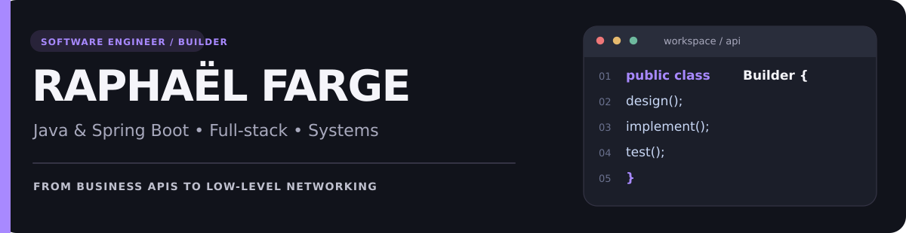
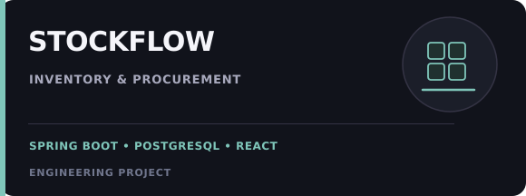
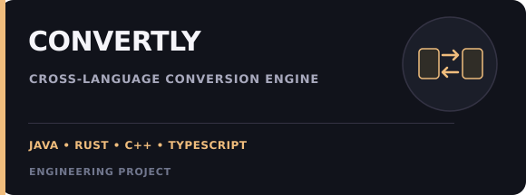
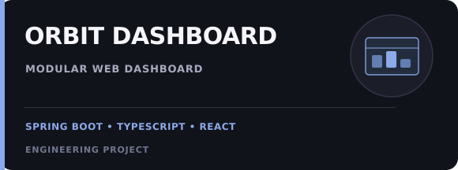

 

**Software Engineering @ Epitech** &nbsp; · &nbsp; **Bordeaux, France** &nbsp; · &nbsp; **Backend / Full-stack / Systems**

 

---

### About me

I'm **Raphaël**, a software engineering student at **Epitech Technology** who enjoys building software across the stack: **Java/Spring Boot** services, **React/TypeScript** applications, relational databases, and lower-level **Rust / C / C++** systems.

I like the parts of engineering that happen after the demo works: making business rules correct, structuring code so it stays readable, designing reliable APIs, and testing failure cases.

> Currently focused on **Java backend engineering**, improving **StockFlow**, and building applications I can understand, explain, and maintain end-to-end.

---

## Core web stack

This is the stack I use the most for my main web projects such as **GhostPay** and **StockFlow**.

**Main profile stack:** Java · Spring Boot · Spring Security · PostgreSQL · Flyway · React · TypeScript · Tailwind CSS · Docker

---

## Languages & technologies

### Backend & APIs

### Frontend

### Data, infrastructure & tooling

### Systems & performance

---

## Featured projects

<table>
<tr>
<td width="50%" valign="top">
  
  <h3>GhostPay</h3>
  

    
    
  

  
Offline-first <strong>payment simulation</strong> platform with authenticated terminals, local payment capture, reconnect-and-sync flows, idempotent batch replay, and end-to-end workflow verification.

  
<strong>Stack:</strong> Spring Boot · Spring Security · PostgreSQL · Flyway · React · TypeScript · IndexedDB · Docker

  
<strong>Highlights:</strong> JWT auth, offline queueing, sync idempotency, concurrency handling, Dockerized environment.

  Simulation only — no real-money processing
</td>
<td width="50%" valign="top">
  
  <h3><a href="https://github.com/YetAnotherFactsEnjoyer/StockFlow">StockFlow</a></h3>
  

    
    
  

  
Inventory and procurement application with products, suppliers, relational backend models, and a React workspace. Currently evolving toward stronger backend/frontend integration, authentication, and inventory consistency.

  
<strong>Stack:</strong> Java · Spring Boot · PostgreSQL · React · TypeScript · Tailwind CSS

  
<strong>Highlights:</strong> Product/supplier management, modular frontend, PostgreSQL backend, production-readiness roadmap.

</td>
</tr>
<tr>
<td width="50%" valign="top">
  
  <h3><a href="https://github.com/Xartania/Convertly">Convertly</a></h3>
  

    
    
  

  
Cross-language file conversion platform connecting a web interface and REST backend to a dedicated scripting engine with a <strong>C++ tokenizer</strong> and <strong>Rust parser/interpreter</strong>.

  
<strong>Stack:</strong> Spring Boot · TypeScript · C++ · Rust · REST

  
<strong>Highlights:</strong> Multi-language architecture, parser/interpreter work, Java backend integration.

</td>
<td width="50%" valign="top">
  
  <h3>Orbit Dashboard</h3>
  

    
    
  

  
Modular dashboard exploring third-party integrations, OAuth-connected widgets, public and authenticated experiences, and feature-based UI architecture.

  
<strong>Stack:</strong> Java · Spring Boot · React · TypeScript · PostgreSQL

  
<strong>Highlights:</strong> Widget architecture, OAuth integrations, mixed public/authenticated user flows.

</td>
</tr>
</table>

---

## Systems engineering

| Project | What I worked on | Technologies |
| :-- | :-- | :-- |
| **Zappy** | Event-driven multiplayer TCP server, non-blocking sockets and scheduled client commands | Rust · TCP/IP · Event loop |
| **Systems coursework** | FTP server, Unix-shell behavior, networking and low-level programming | C · C++ · Linux |

## Experience

**Junior Web Developer Intern — Anybug**  
*September – December 2025*

Worked in a four-developer team on existing PHP/Symfony applications: CRUD features, database entities, controllers, forms, validation and frontend interactions. Learned to ship changes within an established codebase.

**Software Engineering — Epitech Technology**  
*2024 – present*

Project-based curriculum across backend development, systems programming, networking, algorithms, web technologies and databases.

---

  Build thoughtfully. Test the failure paths. Keep learning.
   
  <a href="https://github.com/YetAnotherFactsEnjoyer?tab=repositories">Explore repositories</a>

